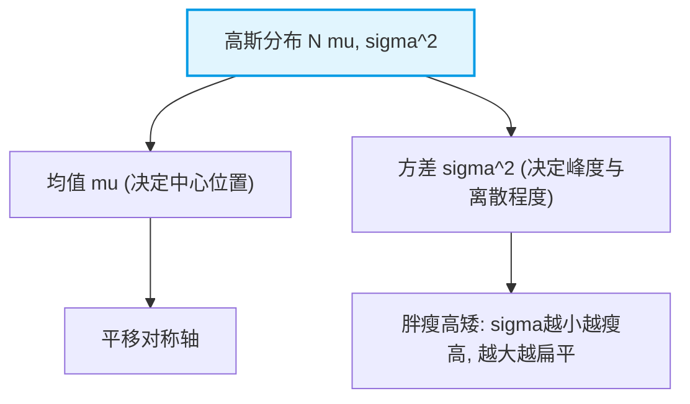

# 3.2.3 高斯分布（Gaussian Distribution）

高斯分布（正态分布，Normal Distribution）是统计机器学习中最核心的概率分布。无论是线性回归的误差假设、变分自编码器（VAE）、扩散模型（Diffusion Models），还是混合高斯模型（GMM），高斯分布都无处不在。

### 1. 核心直观与概率密度函数

一维连续随机变量 $X$ 服从均值为 $\mu$、方差为 $\sigma^2$ 的高斯分布，记作 $X \sim \mathcal{N}(\mu, \sigma^2)$，其概率密度函数（PDF）为：

$$p(x; \mu, \sigma) = \frac{1}{\sqrt{2\pi}\sigma} \exp\left( -\frac{(x - \mu)^2}{2\sigma^2} \right)$$

我们通过一个架构图来理解其核心参数对形态的影响：



### 2. 核心性质

1. **中心极限定理（CLT）**：大量独立同分布（i.i.d.）的随机变量之和近似服从高斯分布，这解释了为什么自然界中噪声普遍呈现高斯特性。
2. **最大熵性质**：在均值和方差已知的条件下，最大熵分布正是高斯分布。这意味着它在信息论中“对不确定性的假设最少、最客观”。

#### 辅助可视化代码片段 (Python / NumPy)

```python
import numpy as np
import matplotlib.pyplot as plt

# 绘制不同均值与方差的高斯分布曲线
mu, sigma = 0, 1
x = np.linspace(-4, 4, 500)
pdf = (1 / (np.sqrt(2 * np.pi) * sigma)) * np.exp(-0.5 * ((x - mu) / sigma) ** 2)

print("高斯分布峰值点 PDF(mu) =", pdf[250])

```

---
