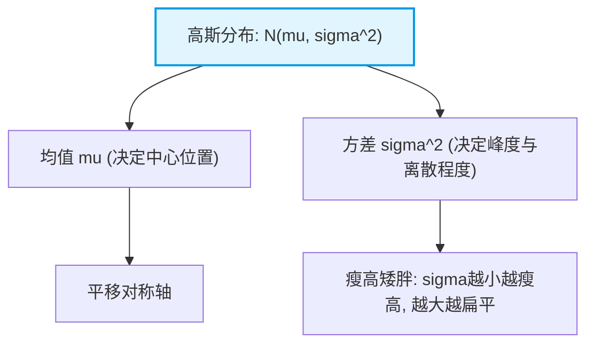

# 3.2.3 高斯分布（Gaussian Distribution）

高斯分布（正态分布，Normal Distribution）是统计机器学习中最核心的概率分布。无论是线性回归的误差假设、变分自编码器（VAE）、扩散模型（Diffusion Models），还是混合高斯模型（GMM），高斯分布都无处不在。

---

### 1. 核心直观与概率密度函数

一维连续随机变量 $X$ 服从均值为 $\mu$、方差为 $\sigma^2$ 的高斯分布，记作 $X \sim \mathcal{N}(\mu, \sigma^2)$，其概率密度函数（PDF）的数学表达式为：


$$
p(x; \mu, \sigma) = \frac{1}{\sqrt{2\pi}\sigma} \exp\left( -\frac{(x - \mu)^2}{2\sigma^2} \right)
$$


我们可以通过下方的架构图来理解其核心参数对形态的影响：



---

### 2. 核心性质与公式组成解析

1. **归一化系数 $\frac{1}{\sqrt{2\pi}\sigma}$**：
* 保证了整个概率密度函数在 $(-\infty, +\infty)$ 上的积分为 $1$。
* 当 $\sigma$ 减小时，系数增大，从而拉高曲线的峰值。


2. **指数衰减项 $-\frac{(x - \mu)^2}{2\sigma^2}$**：
* 呈二次方衰减，代表距离均值 $\mu$ 越远的点，其概率密度呈指数级下降。


3. **中心极限定理（CLT）**：
* 大量独立同分布（i.i.d.）的随机变量之和近似服从高斯分布，这解释了为什么自然界中的噪声普遍呈现高斯特性。


4. **最大熵性质**：
* 在均值和方差已知的条件下，最大熵分布正是高斯分布，表明其对不确定性的假设最少、最客观。


---

### 3. 经典应用场景

在统计机器学习与深度学习工程实践中，高斯分布不仅是一个数学模型，更是连接理论与工业界核心算法的桥梁：

#### ① 回归模型与最小二乘法（Least Squares）

在经典线性回归中，若假设因变量的观测误差服从均值为零的高斯分布 $\epsilon \sim \mathcal{N}(0, \sigma^2)$，通过极大似然估计（MLE）求解，可以严格证明最小二乘法所采用的均方误差（MSE）损失函数本质上就等价于高斯噪声下的最大似然估计。


#### ② 变分自编码器（VAE）与生成扩散模型（Diffusion Models）

在现代深度生成模型中，高斯分布是隐空间建模和噪声注入的标准选择：

* **VAE**：编码器输出隐变量的均值 $\mu$ 与对数方差 $\log \sigma^2$，并通过假设隐空间服从标准正态分布来计算 KL 散度正则化。
* **Diffusion Models**：前向加噪过程被数学建模为向图像连续施加高斯噪声的马尔可夫链。

```mermaid
graph TD
    subgraph 变分自编码器 VAE
        A1[输入图像] --> B1[编码器 Encoder] --> C1["输出参数: mu, sigma^2"] --> D1[采样标准高斯噪声 z]
    end
    subgraph 扩散模型 Diffusion
        A2[原始图像 x_0] -->|逐步添加高斯噪声| B2[加噪过程: q x_t | x_{t-1}] --> C2[纯高斯噪声 x_T]
    end
    style C1 fill:#fff9c4,stroke:#fbc02d,stroke-width:2px
    style C2 fill:#ffebee,stroke:#c62828,stroke-width:2px

```

#### ③ 高斯混合模型（GMM, Gaussian Mixture Model）

用于无监督聚类和复杂概率密度估计。GMM 假设所有样本数据是由多个不同权重的高斯分布叠加组合而成的，通过**期望最大化（EM）算法**来迭代估计每个分量的参数。

```mermaid
graph TD
    A[复杂多峰数据集] -->|混合假设| B["GMM: 多个高斯分量叠加 sum(pi_k * N(mu_k, Sigma_k))"]
    B -->|期望最大化算法 EM| C[E步: 计算后验概率 | M步: 更新均值与协方差]
    C --> D[无监督聚类与密度估计结果]
    style B fill:#f3e5f5,stroke:#7b1fa2,stroke-width:2px

```

#### ④ 卡尔曼滤波与状态估计（Kalman Filtering）

在机器人学、自动驾驶轨迹跟踪和控制系统中，高斯分布被用来优雅地表征传感器噪声和系统状态估计的不确定性，从而实现实时的最优状态估计与传感器融合。

```mermaid
graph LR
    A[预测阶段: 基于物理模型预测状态及高斯不确定性] --> B[更新阶段: 结合传感器观测数据] --> C[卡尔曼增益调节] --> D[输出最优状态估计 N(x, P)]
    style D fill:#e0f7fa,stroke:#00838f,stroke-width:2px

```

```

```
