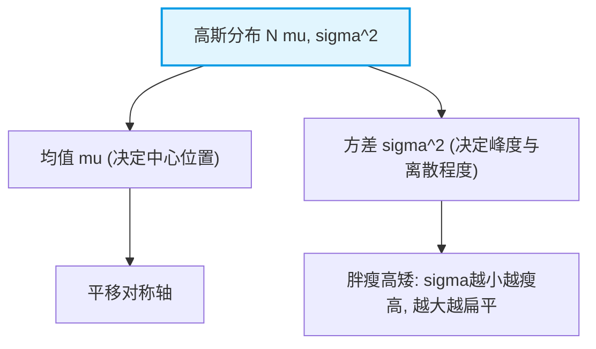
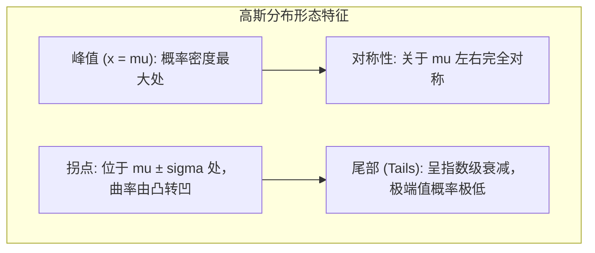

# 3.2.3 高斯分布（Gaussian Distribution）

高斯分布（正态分布，Normal Distribution）是统计机器学习中最核心的概率分布。无论是线性回归的误差假设、变分自编码器（VAE）、扩散模型（Diffusion Models），还是混合高斯模型（GMM），高斯分布都无处不在。

### 1. 核心直观与概率密度函数

一维连续随机变量 $X$ 服从均值为 $\mu$、方差为 $\sigma^2$ 的高斯分布，记作 $X \sim \mathcal{N}(\mu, \sigma^2)$，其概率密度函数（PDF）为：

$$p(x; \mu, \sigma) = \frac{1}{\sqrt{2\pi}\sigma} \exp\left( -\frac{(x - \mu)^2}{2\sigma^2} \right)$$

我们通过一个架构图来理解其核心参数对形态的影响：



### 2. 核心性质

1. **中心极限定理（CLT）**：大量独立同分布（i.i.d.）的随机变量之和近似服从高斯分布，这解释了为什么自然界中噪声普遍呈现高斯特性。
2. **最大熵性质**：在均值和方差已知的条件下，最大熵分布正是高斯分布。这意味着它在信息论中“对不确定性的假设最少、最客观”。

#### 辅助可视化代码片段 (Python / NumPy)

```python
import numpy as np
import matplotlib.pyplot as plt

# 绘制不同均值与方差的高斯分布曲线
mu, sigma = 0, 1
x = np.linspace(-4, 4, 500)
pdf = (1 / (np.sqrt(2 * np.pi) * sigma)) * np.exp(-0.5 * ((x - mu) / sigma) ** 2)

print("高斯分布峰值点 PDF(mu) =", pdf[250])

```

以下是**高斯分布**与**拉普拉斯变换**在机器学习、工程和数学中的核心应用场景，并配以直观的图形与曲线描述，方便您直接补充到 GitBook 中。

---

## 应用场景与曲线描述

高斯分布（正态分布）不仅是描述自然界随机误差的标准模型，也是现代机器学习和人工智能算法的基石。

### 1. 核心应用场景

* **回归模型中的误差假设（Least Squares）**：
在经典线性回归中，假设因变量的误差项服从均值为 0 的高斯分布 $\epsilon \sim \mathcal{N}(0, \sigma^2)$。通过极大似然估计（MLE）推导，可以证明最小二乘法的均方误差（MSE）损失函数本质上就等价于高斯噪声下的最大似然估计。
* **变分自编码器（VAE）与扩散模型（Diffusion Models）**：
* 在 VAE 中，编码器通常被用来输出隐变量的均值 $\mu$ 和方差 $\log \sigma^2$，假设隐空间服从标准正态分布。
* 在现代扩散模型（如 DDPM）中，前向过程（Forward Process）是通过连续向图像添加高斯噪声直至其变成纯白噪声。


* **高斯混合模型（GMM, Gaussian Mixture Model）**：
用于无监督聚类和密度估计。它假设所有的数据样本都是由多个未知的高斯分布组合而成的，通过期望最大化（EM）算法来估计每个高斯分量的参数。
* **卡尔曼滤波（Kalman Filtering）**：
在机器人学、自动驾驶和控制系统中，高斯分布被用来表示传感器噪声和状态估计的不确定性，实现实时最优状态估计。

---

### 2. 曲线特征与可视化描述

高斯分布的概率密度函数呈现出典型的“钟形曲线”（Bell Curve）。



**ASCII 文本曲线示意：**

```text
      p(x)
       ^
       |          _--_
       |         /    \        <- 较小的 sigma（瘦高，数据更集中）
       |        /      \
       |       /   _--_ \      <- 较大的 sigma（扁平，数据更分散）
       |      /   /    \ \
       +----------------------------> x
             mu-sigma  mu  mu+sigma

```

---

## 应用场景与变换描述

拉普拉斯变换是一种强有力的数学工具，它通过积分变换将复杂的时间域（或空间域）微积分运算，转化为复频域的代数运算。

### 1. 核心应用场景

* **概率论中的矩母函数（MGF）与特征函数**：
在推导概率分布的数学特征时，矩母函数 $M_X(t) = \mathbb{E}[e^{tX}]$ 本质上就是概率密度函数的拉普拉斯变换。利用它，我们可以极其简便地求出任意阶的矩（如均值、方差、偏度、峰度）。此外，它在证明中心极限定理（CLT）时起到了关键的桥梁作用。
* **控制工程与信号处理（线性系统分析）**：
在分析动态系统（如机器人关节控制、电机驱动、电路滤波器）时，系统的物理规律通常由高阶线性常微分方程描述。通过拉普拉斯变换，微分方程转化为代数方程（传递函数 $H(s)$），极大地简化了系统稳定性（如极零点分析）的计算。
* **排队论与随机过程**：
在计算机网络、服务器负载分析或运筹学中，到达时间或服务时间通常服从指数分布。处理多级排队网络或生灭过程时，拉普拉斯变换是求解其暂态概率分布的标准工具。
* **金融工程（期权定价）**：
在求解 Black-Scholes 期权定价偏微分方程时，金融数学家经常使用拉普拉斯变换或其变体（如傅里叶变换）来获得欧式期权的解析解。

---

### 2. 变换流向与空间映射描述

拉普拉斯变换的核心思想是“降维打击”——把时域中难以直接求解的微积分问题，搬到复频域变成简单的乘除法。

```mermaid
graph LR
    A["时域 / 原空间 f(t) <br> (复杂的微分方程、概率积分)"] -->|Laplace 积分变换 <br> \int_0^\infty e^{-st} f(t) dt| B["复频域 / s 空间 F(s) <br> (简单的代数方程、多项式乘除)"]
    B -->|代数求解 / 简化运算| C["得出频域解 F(s)"]
    C -->|逆拉普拉斯变换 <br> \mathcal{L}^{-1}| D["返回时域 / 结果 f(t)"]
    style A fill:#ffebee,stroke:#c62828,stroke-width:2px
    style B fill:#e8f5e9,stroke:#2e7d32,stroke-width:2px
    style D fill:#e3f2fd,stroke:#1565c0,stroke-width:2px

```

* **直观理解**：就像对巨大复杂的数字做乘法很麻烦，我们可以通过**对数（Log）**把乘法变成加法一样；拉普拉斯变换则是把**微积分**变成**代数**的“对数”。在机器学习背后推导某些连续随机变量的和、卷积或复合分布时，这种变换往往能让原本不可解的积分迎刃而解。


---
